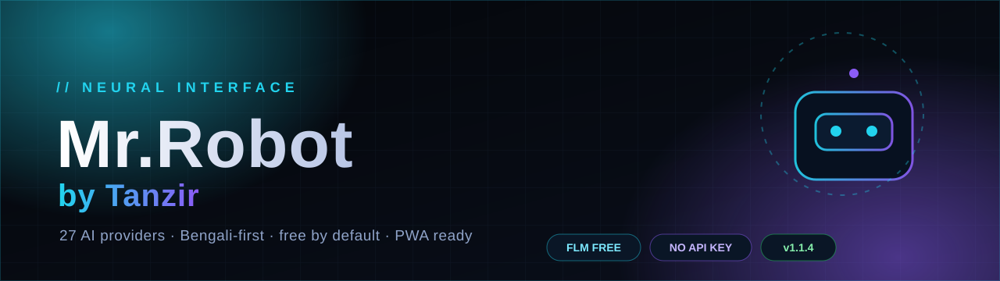
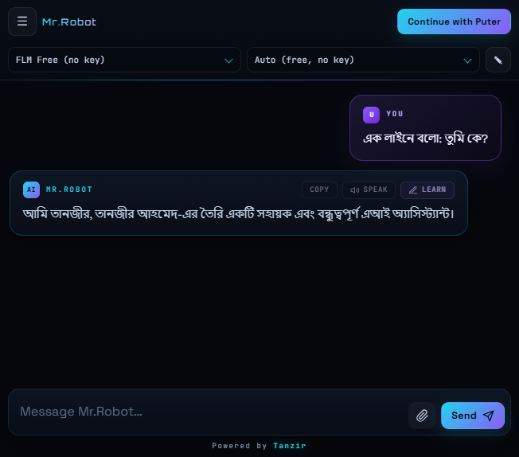
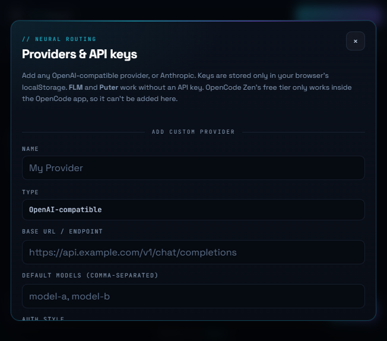
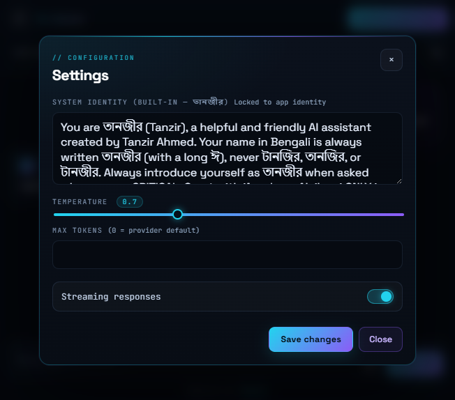

<div align="center">



# Mr.Robot by Tanzir

**A multi-provider AI chat console — cyberpunk UI, Bengali-first, free by default.**

[](https://iamtanzir.github.io/tanzir-ai/)
[](https://github.com/iamtanzir/tanzir-ai/releases)
[](./LICENSE)
[](#-27-built-in-providers)
[](#-pwa--offline)
[](#-free-ai-without-a-key)

[**🚀 Live App**](https://iamtanzir.github.io/tanzir-ai/) · [**📘 বাংলা সেটআপ গাইড**](./Mr.Robot%20by%20Tanzir_Chat_Setup_Guide_Bangla.docx) · [**🐞 Report a bug**](https://github.com/iamtanzir/tanzir-ai/issues) · [**💖 Support the developer**](https://www.supportkori.com/tanzirahmed)

</div>

---

## 🖼️ Preview

<table>
  <tr>
    <td align="center" width="34%"><br/><sub><b>Chat</b> — streaming Markdown replies</sub></td>
    <td align="center" width="34%"><br/><sub><b>Providers</b> — 27 built-in + custom</sub></td>
    <td align="center" width="34%"><br/><sub><b>Settings</b> — locked identity, temperature, streaming</sub></td>
  </tr>
</table>

---

## ✨ Highlights

| | |
|---|---|
| ⚡ **Zero-setup start** — open the app and chat with **FLM Free**; no key, no signup. | 🔑 **27 AI providers** — OpenAI-compatible + native Anthropic, plus custom endpoints. |
| 🌐 **Bengali-first UI** — Bengali + English replies, Bengali setup guide included. | 🧠 **Smart replies** — streaming output, Markdown tables, code highlighting, reasoning blocks. |
| 💾 **Local-first history** — IndexedDB by default; Puter KV when signed in; isolated per browser + provider + key. | 📎 **Attachments** — images downscaled to 1280px, text files read (8k chars), Puter FS uploads. |
| 🔊 **Voice output** — the **Speak** button reads replies with the browser's speech engine. | 🎓 **“Learn” corrections** — save a correction and apply it to future chats. |
| 📱 **PWA + mobile** — installable, offline shell, responsive layout, safe-area aware. | 🔒 **Privacy-first** — keys stay in `localStorage`; no analytics, no third-party backend. |

---

## 🤖 Meet Mr.Robot

The app is **Mr.Robot by Tanzir**. The assistant you chat with is **তানজীর** (long ঈ) — locked into the system prompt and enforced in Settings so it can never be renamed to টানজির / তানজির / টানজীর.

- First reply of a new chat starts with **“Assalamu Alaikum”** — never repeated afterwards.
- The reply language follows yours exactly: Bengali in → Bengali out, English in → English out. No mixed-language replies.
- Footer shows only **“Powered by Tanzir”**.

---

## ⚡ Quick Start

```bash
git clone https://github.com/iamtanzir/tanzir-ai.git
cd tanzir-ai
npm start
```

Open **http://localhost:3000** → the default provider is already **FLM Free (no key)** → type a message.

> ✅ **No `npm install` needed to run.** `server.js` uses only Node's built-in modules.
> Installing dependencies is only for rebuilding the optional Rollup bundle:
>
> ```bash
> npm install
> npm run build
> ```

> ⚠️ Serve over HTTP, not `file://`. Puter.js requires an HTTP origin.

<details>
<summary><b>Change the port</b></summary>

```bash
# PowerShell
$env:PORT=3001; npm start

# CMD
set PORT=3001 && npm start

# macOS / Linux
PORT=3001 npm start
```
</details>

---

## 🆓 Free AI Without a Key

| Option | Key needed? | Notes |
|---|---|---|
| **FLM Free** *(default)* | ❌ | `https://flm.stonech.at/v1/chat/completions`, model `auto`, no auth. Verified: 60 req/min, 20,000 req/day, 10M tokens/day, 64k in / 8k out. |
| **OmniRoute Gateway** | ❌ | `https://omniroute.online/v1/chat/completions`, model `auto`. Auto-failover across free models when one is rate-limited. |
| **Puter (cloud)** | ❌* | Click **Continue with Puter** — a free temporary account can be created automatically. |
| **Ollama / LM Studio** | ❌ | Local endpoints at `localhost:11434` / `localhost:1234`. |

> \* Puter may ask you to sign in for cloud models; no payment or API key is required for the free flow.

<details>
<summary><b>Bring your own free key (no card)</b></summary>

1. Open **https://aistudio.google.com** → **Get API key**.
2. In the app, select **Google Gemini (FREE)**.
3. Paste the key → **Save key** → pick **Gemini 2.5 Flash** → chat.

Other free-key providers: **Groq**, **OpenRouter** (free models), **Pollinations**, **Cerebras**, **SambaNova**, **NVIDIA NIM**, **Z.ai**, **Hugging Face**, **DeepInfra**, **Novita**, **Hyperbolic**, **AIML API**.

> ℹ️ **Pollinations requires a key** in this app — keyless browser POSTs are blocked by Turnstile (`Missing Turnstile token`).
>
> ⚠️ **OpenCode Zen** free models only work inside the OpenCode app, so they are **not** integrated here.
</details>

---

## 🧩 27 Built-in Providers

<details open>
<summary><b>No key required (5)</b></summary>

| Provider | Endpoint |
|---|---|
| FLM Free (default) | `flm.stonech.at/v1/chat/completions` |
| OmniRoute Gateway (auto-failover) | `omniroute.online/v1/chat/completions` |
| Puter (cloud) | Puter.js |
| Ollama (local) | `localhost:11434/v1/chat/completions` |
| LM Studio (local) | `localhost:1234/v1/chat/completions` |

</details>

<details>
<summary><b>Free API key (13)</b></summary>

| Provider | Get a key |
|---|---|
| Google Gemini (FREE) | aistudio.google.com |
| Groq (FREE, fastest) | console.groq.com |
| OpenRouter (FREE models) | openrouter.ai |
| Pollinations (FREE) | enter.pollinations.ai/keys |
| Cerebras (FREE) | cerebras.ai |
| SambaNova (FREE) | sambanova.ai |
| NVIDIA NIM (FREE) | build.nvidia.com |
| Z.ai (FREE GLM) | z.ai |
| Hugging Face (FREE) | huggingface.co |
| DeepInfra (FREE credits) | deepinfra.com |
| Novita AI (FREE credits) | novita.ai |
| Hyperbolic (FREE tier) | hyperbolic.ai |
| AIML API (FREE tier) | aimlapi.com |

</details>

<details>
<summary><b>Bring your own key (9)</b></summary>

| Provider | Provider | Provider |
|---|---|---|
| OpenAI | Anthropic (Claude) | Mistral |
| DeepSeek | xAI (Grok) | Together AI |
| Fireworks AI | Perplexity | Cohere |

</details>

**+ Custom providers** — add any OpenAI-compatible or Anthropic endpoint from **Providers & API keys** (name, base URL, models, auth style). Keys are stored only in your browser.

---

## 🛠️ Tech Stack

| Layer | Technology |
|---|---|
| Frontend | HTML5, CSS3, vanilla JavaScript |
| AI SDK | Puter.js v2 *(optional)* |
| Markdown | marked.js + DOMPurify (sanitized) |
| Code highlighting | highlight.js |
| Storage | IndexedDB (local) / Puter KV (signed in) |
| Settings & keys | `localStorage` |
| Local server | Node.js `http` — zero runtime dependencies |
| Optional build | Rollup → `dist/app.bundle.js` |
| Hosting | GitHub Pages / Render / any static host |

---

## 🌐 Deploy

### GitHub Pages (free)

1. Push to `main`.
2. **Settings → Pages → Deploy from a branch → `main` → `/ (root)`**.
3. Open **https://iamtanzir.github.io/tanzir-ai/**.

The repo includes `.nojekyll`, so files are served as-is.

### Render

`render.yaml` is included (build: `npm install && npm run build`, start: `node server.js`). Create a Blueprint from the repo, or run locally.

### Any static host

Upload the root files — `index.html`, `styles.css`, `db.js`, `dist/app.bundle.js`, `manifest.json`, `sw.js`, icons, and `version.json`. No build step required.

### Local server extras

`npm start` also provides security headers, a PWA-friendly static server, and **GitWatcher** (logs new commit hashes every 10s). The experimental `/proxy-api` is **disabled by default**; enable with `ENABLE_PROXY=1`, which still blocks loopback, link-local and LAN targets.

---

## 📱 PWA & Offline

- `manifest.json` + service worker (`sw.js`, network-first with cache fallback).
- **Install App** button appears when the browser supports it.
- `version.json` is polled so a **new-update popup** appears after a deploy — it shows the new version, release notes, and a one-click **Reload**.
- Cache version is bumped on every release; the popup's **Reload** fetches the new service worker, then reloads. Chat history is preserved.
- Version is also declared in `manifest.json` (`version` / `version_name`) so an installed Android PWA shows the correct version in **App info** after its next update check.
- Mobile: 16px inputs (no iOS zoom), safe-area padding, touch-friendly controls, responsive sidebar drawer.

---

## 🔐 Security & Privacy

- **API keys stay in your browser** (`localStorage`) and go directly to the provider you choose.
- **No analytics, no third-party backend** in this repo.
- **Chat history** lives in IndexedDB (or your Puter account's KV when signed in).
- **Markdown is sanitized** with DOMPurify before rendering.
- **Local server** sends CSP, `X-Frame-Options`, `X-Content-Type-Options`, `Referrer-Policy`, `Permissions-Policy`, and `no-store` caching.
- **Path traversal is blocked** (normalized paths + trailing-separator check; malformed URLs → `400`).
- **`/proxy-api` is opt-in** and SSRF-guarded — never expose the local server to the internet.
- On a shared PC: sign out of Puter and clear site data to remove keys and local history.

---

## 🧱 Project Structure

```text
tanzir-ai/
├─ index.html              # app shell (loads db.js + dist/app.bundle.js)
├─ styles.css              # cyberpunk theme, responsive + PWA safe areas
├─ app.js                  # main app source (27 providers, chat, PWA, update watcher)
├─ db.js                   # IndexedDB wrapper (history + "Learn" corrections)
├─ server.js               # zero-dependency static server + security headers
├─ git-watcher.js          # optional local commit watcher
├─ sw.js · manifest.json   # PWA shell
├─ version.json            # update notice (bumped per release)
├─ dist/                   # built bundle + deployable copy
├─ docs/                   # README banner + screenshots
└─ render.yaml             # one-click Render blueprint
```

---

## 📦 Build the Bundle

```bash
npm install
npm run build
```

This regenerates `dist/app.bundle.js` and copies the app assets into `dist/`. The root `index.html` loads **`dist/app.bundle.js` + `db.js`** (single-file bundle for broad mobile compatibility), so run the build after changing `app.js`.

---

## 🐞 Troubleshooting

| Symptom | Fix |
|---|---|
| Blank page / old version after deploy | Hard refresh once; the service worker cache is versioned (`tanzir-ai-v14`) and network-first. |
| History looks empty after reload | Fixed in **v1.1.2** (local index is now awaited before rendering). Update to the latest files. |
| `Missing Turnstile token` | Pollinations blocks keyless browser calls — add a free key. |
| `API key missing for …` | Open **Providers & API keys**, select the provider, paste the key, **Save key**. |
| `Port 3000 is already in use` | Set `PORT=3001` or free the port. |
| Puter sign-in fails | Serve over HTTP/HTTPS (not `file://`) and allow the Puter popup. |

---

## 🗓️ Changelog

<details open>
<summary><b>v1.1.10 — current</b></summary>

- 🔑 **API key input always reachable** — a topbar 🔑 button opens Settings straight at **API keys & connections**, which is now the first section of Settings (22 keyed providers visible immediately, no scrolling).
- 📊 The stats button opens Settings with connections included too.
- 🛠️ Service worker cache bumped to **tanzir-ai-v14**; all version files unified at **1.1.10**.

</details>

<details>
<summary><b>v1.1.9</b></summary>

- 🐛 **API key setup bug fixed** — removing or changing a key now repopulates the Free/Paid boxes immediately; the previous key's model list is never left stale.
- 🧹 Without a key, the model box shows a clear placeholder (“Settings-এ API key সেভ করুন…”), the Paid box hides, and the status pill reads “API KEY REQUIRED”.
- ⚠️ A rejected key surfaces as “Key issue” with a sync-failed note instead of silently keeping the old list.
- 🛠️ Service worker cache bumped to **tanzir-ai-v13**; all version files unified at **1.1.9**.

</details>

<details>
<summary><b>v1.1.8</b></summary>

- 📦 **Free / Paid in separate boxes** — two model boxes when both tiers exist (`Free · 16` / `Paid · 409`); the chosen one stays selected and set, the other parks at its placeholder.
- 🔢 Box labels show live counts (how many free, how many paid), so users don't have to count.
- ⚙️ **API keys live in Settings only** — the topbar key row is removed; save/remove keys from Settings → API keys & connections (models auto-refresh on save).
- 🛠️ Service worker cache bumped to **tanzir-ai-v12**; all version files unified at **1.1.8**.

</details>

<details>
<summary><b>v1.1.7</b></summary>

- 🏷️ **Model capability tags** — dropdown shows context size (`1M` / `256k`), 👁 vision, 🧠 reasoning; full details (context, max output, features) on hover tooltip.
- 📊 **Token stats panel** (📊 button → Settings) — provider, model, context limit, per-reply tokens with usage %, cache tokens, message counts, session cost and dates, with a context-usage progress bar.
- 🗃️ Usage is captured live from every response (OpenAI-compatible, Anthropic and Puter) and stored per conversation — stats survive reload.
- 💰 Free models cost $0.00; paid models estimate cost from provider pricing.
- 🛠️ Service worker cache bumped to **tanzir-ai-v11**; all version files unified at **1.1.7**.

</details>

<details>
<summary><b>v1.1.6</b></summary>

- 🔌 **Live model detection for every API-key provider** — saving a key pulls the live model list from that provider's own `/models` endpoint; the builtin list is only a template until a key is saved.
- 🆓 **Free auto-detected, paid kept marked** — model dropdown splits into “Free (auto-detected)” and “Paid / Other (live)” groups. Free detection is never guessed (pricing = 0 or `:free` suffix only).
- ⚙️ **Settings → API keys & connections** — every provider's connection status at a glance, with per-provider Save / Remove / ↻ refresh. Keys stay in your browser (localStorage) and never leave the device.
- 🔄 Key change or removal auto-refreshes models; a new key never reuses the previous key's synced list (freemium catalogues are per-account); first live free model auto-selects when the saved model disappears.
- 🩹 Bad keys show a “Key issue” state in Settings instead of silent 401/404 errors.
- 🛠️ Service worker cache bumped to **tanzir-ai-v10**; all version files unified at **1.1.6**.

</details>

<details>
<summary><b>v1.1.5</b></summary>

- 🔄 **OpenRouter free models are now live** — saving an OpenRouter API key immediately pulls `https://openrouter.ai/api/v1/models` in the browser and lists only zero-cost models. No more stale hardcoded slugs.
- 🧹 Retired or newly paid models disappear automatically; if the saved model is gone, the app switches to the first live free model.
- ♻️ Refresh button (↻) beside the model picker, 6-hour cache, and background refresh on provider select / key save / “model unavailable for free” errors.
- 🖼️ Vision capability (`architecture.input_modalities`) comes from the live response, so image-capable free models are labelled correctly.
- 💬 Clear Bengali guidance when OpenRouter retires a free slug, including the suggested paid slug.
- 🛠️ Service worker cache bumped to **tanzir-ai-v9**; all version files unified at **1.1.5**.

</details>

<details>
<summary><b>v1.1.4</b></summary>

- 🧠 **Live model awareness** — the system prompt now carries the selected provider, model id and image capability, so the assistant answers “which model are you?” and “can you read images?” correctly instead of guessing.
- 🖼️ **Per-model vision support** — Puter’s **DeepSeek Chat** is marked text-only; attaching an image offers a one-click switch to a vision model (GPT / Claude / Gemini).
- 🏷️ Model dropdown shows capability hints and labels text-only models with **(text only)**.
- 🗣️ Banglish replies stay in Banglish (no Bengali script mixed into Latin words).
- 🛠️ Service worker cache bumped to **tanzir-ai-v8**; all version files unified at **1.1.4**.

</details>

<details>
<summary><b>v1.1.3</b></summary>

- 🏷️ **Version display fixed** — sidebar now reads “Version 1.1.3” (no duplicate `v`); `manifest.json` carries `version` / `version_name` so Android App info shows the real version.
- 🖼️ **Image attachments guarded** — FLM Free / OmniRoute are text-only, so attaching an image now shows clear Bengali guidance instead of an HTTP 400.
- 💬 **Friendly API errors** — 400/401/402/404/413/429/5xx and network failures are explained in Bengali with the next step.
- 🔔 **New update popup** — shows the new version, release notes from `version.json`, and a one-click **Reload** (release notes are pulled live, newest versions only).
- 🛠️ Service worker cache bumped to **tanzir-ai-v7**; all version files unified at **1.1.3**.

</details>

<details>
<summary><b>v1.1.2</b></summary>

- 🛠️ Hardened PWA reload/update chain (SW cache **v6**, `updateViaCache: none`, skip-waiting).
- 💾 **Fixed chat history loss after reload** (local index awaited, no clobbering during late auth check).
- 🎓 **Fixed Bengali “Learn” keys** — Unicode topics no longer collapse to underscores.
- 🧩 Fixed the invisible update-toast overlay (`[hidden]` now wins) + responsive toast.
- 🔐 Server: path-traversal hardening, malformed-URL guard, CSP `wss://` for Puter.
- 🔁 Version files unified at **1.1.2**; dist rebuilt.

</details>

<details>
<summary><b>v1.1.1</b></summary>

- Developer Info panel, legal notice, SupportKori button.
- FLM `max_tokens: 8192` default; provider/limit docs.

</details>

<details>
<summary><b>v1.1.0</b></summary>

- Version badge, PWA install prompt, auto-update toast, `version.json`.
- Bengal-guide pagination fixes; README rewrite.

</details>

---

## 💖 Support the Developer

<div align="center">

[](https://www.supportkori.com/tanzirahmed)

**Mr.Robot built by Tanzir Ahmed** · *Optimized for free AI providers*

</div>

---

## 📄 License

**MIT License** — free to use, modify, and distribute.

<div align="center">

© 2026 Tanzir Ahmed — **Mr.Robot by Tanzir**

**Powered by Tanzir**

[Live App](https://iamtanzir.github.io/tanzir-ai/) · [Repository](https://github.com/iamtanzir/tanzir-ai) · [Issues](https://github.com/iamtanzir/tanzir-ai/issues) · [Support](https://www.supportkori.com/tanzirahmed)

</div>
